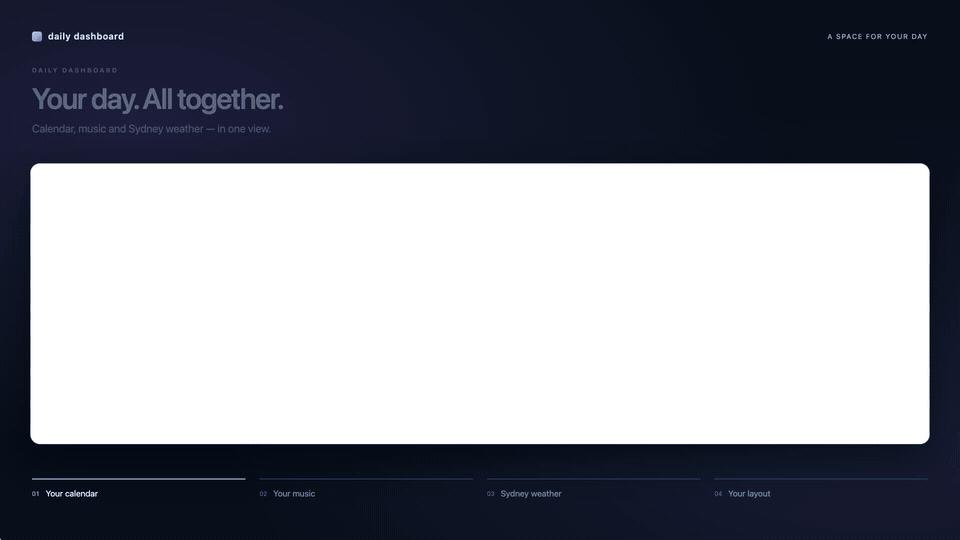

# Daily Dashboard

**A dashboard for your additional display—especially a small ultrawide screen.**

Built for a **1280 × 400 companion display**, with calendar, music, weather, and clock widgets. Move and resize them to fit your screen, and adjust the application scale in Settings.

[Watch the 27-second demo in 1080p](docs/videos/dashboard-demo-anonymous.mp4)

## Widgets

- **Calendar:** day, workweek, and week views with event details.
- **Spotify:** album artwork, track details, and desktop playback controls.
- **Weather:** current conditions, hourly and five-day forecasts, and rain radar. The forecast advances at midnight in the weather location's time zone and catches up after sleep.
- **Clock:** analog and digital faces with time zone selection.
- **Layout:** move, resize, stack, or hide widgets.

Live aircraft and terminal widgets are also available. With all widgets hidden, the app shows an idle background: animated waves, a fish pond, a night sky, a map, or an album slideshow.

## Get started

1. [Download a build from GitHub Releases](https://github.com/BananaAficionado/DailyDashboard/releases).
2. Place the dashboard on your additional display and choose your widgets. Adjust the application scale in Settings to suit the screen.
3. Open Spotify, choose a weather location, and connect a calendar if you want one. Google and Microsoft calendar connections require your own provider credentials; see the [integration setup guide](Contributing.md#integrations-and-credentials).

On **Windows**, use **Settings → General → Dedicated display** to keep the dashboard on a chosen physical monitor. See the [display guide](docs/dedicated-display.md) for setup and recovery. On **macOS**, place and resize the app as a normal window.

Updates notify you by default; automatic downloads and installation are opt-in. See the [update guide](docs/startup-updates.md).

> **Personal project · Work in progress.** Shared as-is; features, integrations, and platform support are still evolving.

## For developers

See [Contributing.md](Contributing.md) for development setup, provider configuration, platform builds, testing, and release preparation.
